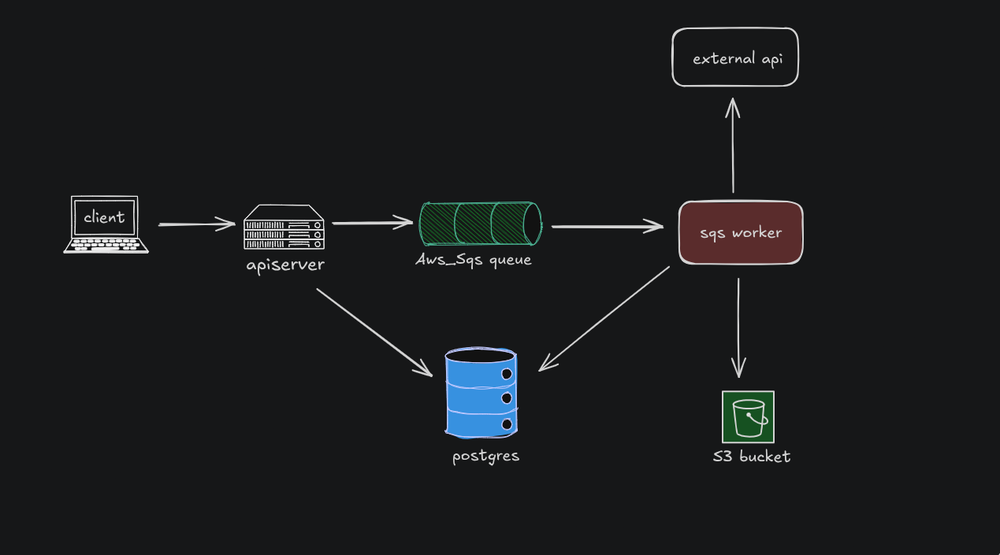

# Drift

Drift is a distributed background report-processing system written in Go. It uses PostgreSQL as the source of truth, a transactional outbox to publish report jobs to Amazon SQS, independent worker processes to execute them, and Amazon S3 to store generated reports.

The design focuses on reliable job publication, fenced worker ownership, explicit retry boundaries, and at-least-once delivery.

## Architecture



The API and worker run as separate processes. The outbox publisher runs inside the API process. PostgreSQL stores both report state and publication state, SQS carries jobs, and S3 stores generated reports.

## How It Works

### Transactional outbox

When a report is requested, the API creates two records in the same PostgreSQL transaction:

- the `reports` row,
- the corresponding `report_outbox` row.

Both records commit together or neither does. This prevents the dual-write failure where a report exists but its job was never made durable.

### Concurrent outbox publishing

The outbox publisher periodically claims pending entries using a CTE with `FOR UPDATE SKIP LOCKED`, so multiple API instances can claim disjoint batches without blocking one another.

Each claimed batch receives one UUID claim token, which is written alongside a lease to every row in that batch. Messages are sent to SQS outside the database transaction, and successful publications are recorded with a token-fenced update.

There is an intentional failure window: SQS may accept a message, but the publisher may crash before recording `published_at` in PostgreSQL. Once the lease expires, another publisher can send the same message again. Publication is therefore at-least-once, not exactly-once.

### Worker ownership and fencing

Workers consume messages from an SQS Standard queue and claim reports through a conditional PostgreSQL update.

A successful claim:

- changes the report status to `processing`,
- assigns a fresh UUID claim token,
- sets a three-minute lease,
- increments `processing_attempts`.

The worker renews the lease every two minutes. Lease renewal, completion, and failure all require the current claim token, so a stale worker cannot modify a report that another worker has reclaimed.

Duplicate SQS deliveries use the same ownership model. If the report still has a live lease, the duplicate worker cannot claim it and defers the message for 60 seconds. If the report is already terminal, the duplicate message is deleted.

### Retry boundaries

The system has three independent retry mechanisms:

| Boundary | Responsibility |
| --- | --- |
| Outbox retries | Publishing jobs from PostgreSQL to SQS |
| Dependency retries | Transient Loz and S3 failures within one report claim |
| Report claims | Reclaiming a report after a transient failure or worker crash |

Dependency calls use a shared retry package with exponential backoff, jitter, and context-aware cancellation:

| Setting | Value |
| --- | --- |
| Initial delay | `2s` |
| Maximum delay | `30s` |
| Maximum retries | `4` |
| Total attempts | `5` |
| Jitter | `±20%` |

Permanent dependency errors stop retrying immediately. Transient errors are retried. The AWS SDK's own operation retries are disabled so the shared retry policy controls S3 behavior.

Dependency retries do not increment `processing_attempts`. One report claim can make several Loz and S3 attempts without consuming several report claims.

When dependency retries are exhausted, the worker does not immediately mark the report failed. It leaves the SQS message unacknowledged and the report remains `processing` until its lease expires. A later delivery can then claim it again.

Reports have a default processing limit of five claims. Once that limit is exhausted and no live lease remains, the report transitions to `failed` with `report processing attempts exhausted`.

Outbox entries have a separate policy. An entry is marked dead after 10 permanent-entry failures. Transient and global failures do not consume that budget.

### Output and delivery semantics

Reports are generated as CSV, compressed with gzip, and uploaded to S3 using claim-specific keys:

```text
users/{userID}/reports/{reportID}-{claimToken}.csv.gz
```

A later claim cannot overwrite an earlier claim's output. However, a worker can crash after uploading and before recording completion in PostgreSQL, leaving an orphaned object. Database fencing protects report state, not external side effects.

SQS provides at-least-once delivery. Duplicate messages are expected, and the database claim prevents duplicate report execution. The system does not guarantee exactly-once execution of external side effects.

## Local Development

Local services run with Docker Compose. LocalStack emulates SQS and S3, and Terraform provisions the local queue and bucket against the LocalStack endpoints.

The LocalStack service in `docker-compose.yml` expects a `LOCALSTACK_AUTH_TOKEN` environment variable.

```sh
export LOCALSTACK_AUTH_TOKEN="<your-localstack-token>"
docker compose up -d driftdb localstack

source setup.bash
```

Terraform reads variables from a local `terraform/terraform.tfvars`, which is
gitignored. Create it before initializing Terraform:

```sh
cat > terraform/terraform.tfvars <<'EOF'
access_key  = "test"
secret_key  = "test"
region      = "us-west-2"

s3_endpoint  = "http://localhost:4566"
sqs_endpoint = "http://localhost:4566"

bucket_name = "my-test-bucket"
queue_name  = "my-test-queue"
EOF

terraform -chdir=terraform init
terraform -chdir=terraform apply
```

Start the API and worker in separate terminals:

```sh
make run
make worker
```

The API applies migrations at startup. The worker assumes the schema already exists.

## Testing

Start the isolated test database, then run the suite:

```sh
make test-db
make test
```

For static checks:

```sh
go vet ./...
```

## Configuration

Configuration lives in `app.yaml` and can be overridden with environment variables.

Key settings:

- `worker.concurrency` controls the number of in-flight jobs per worker process.
- `worker.retry.*` controls dependency backoff.
- `outbox.*` controls publisher interval, batch size, concurrency, send timeout, claim lease, retry backoff, and cooldown.
- `reportClaimLease` is a code constant of three minutes, renewed every two minutes.

The default report processing limit is five claims and is defined at the database level.

## Known Limitations

- SQS visibility timeout is 30 seconds, while the report lease is three minutes. Workers do not extend SQS visibility during processing, so messages can be redelivered while a worker still owns the report.
- The queue has 24-hour message retention but no dead-letter queue or redrive policy.
- There is no reconciler for lost or expired messages, or for reports left `processing` after their messages disappear.
- `OutboxDB.ReplayDead` exists as a database method but is not exposed through the API, CLI, or a background job.
- The API accepts `foods` reports, but the worker currently only implements `monsters`.
- Delivery is at-least-once; external side effects can happen more than once.

## Stack

- Go
- PostgreSQL
- Amazon SQS
- Amazon S3
- Docker Compose
- LocalStack
- Terraform
